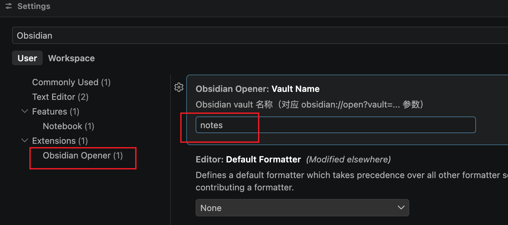

# Obsidian Opener

[English](#english) | [中文](./README.zh-CN.md)

[](https://marketplace.visualstudio.com/items?itemName=leonezhu.obsidian-opener)

## English

Open the Markdown file you are editing in VS Code inside local Obsidian, with one click.

### Install

From the VS Code Marketplace:

**[Obsidian Opener — Visual Studio Marketplace](https://marketplace.visualstudio.com/items?itemName=leonezhu.obsidian-opener)**

Or install from a local `.vsix`:

```bash
npx @vscode/vsce package --allow-missing-repository
code --install-extension obsidian-opener-0.3.0.vsix
```

### Usage

1. **Keyboard shortcut**: `Alt+O` on Windows/Linux, `⌘⌥O` (⌘ + Option + O) on macOS
2. **Button**: a purple gem icon in the top-right corner of a Markdown editor — click it to open the current file in Obsidian
3. **Command Palette**: `Obsidian: Open Current File in Obsidian`

### How it works

The generated URL has two modes:

**Auto mode (default, zero config)** — uses the file's absolute path, and Obsidian matches it against registered vaults; if the file is not inside any vault, new versions of Obsidian open it as a standalone Markdown file:

```
obsidian://open?path=%2FUsers%2Fme%2Fnotes%2FReferences%2FDanKoe%2F2026-08-29-xxx.md
```

**Named vault mode** — set `obsidianOpener.vaultName` to enable, using vault name + relative path:

```
obsidian://open?vault=notes&file=References%2FDanKoe%2F2026-08-29-xxx
```

When you click the button, the extension first verifies whether the current document's repo (workspace root) actually matches that vault's directory in Obsidian's vault registry:

- Match → open with `vault=` + the path relative to the vault root (`.md` suffix stripped, URL-encoded)
- No match (the file belongs to another repo, or no workspace is open) → fall back to the standalone-file method (`path=` absolute path)
- The vault name cannot be resolved from the registry → keep the legacy behavior (assume workspace root = vault root)

### Configuration

Open VS Code Settings, search for "Obsidian", and set **Obsidian Opener: Vault Name** to your vault name (the vault root folder's name, e.g. `notes`):



| Setting | Default | Description |
|---|---|---|
| `obsidianOpener.vaultName` | `""` (empty) | Leave empty for auto mode; set a vault name to open files in that vault, with a standalone-file fallback when the file is not in it |

### Testing

Zero dependencies, uses Node's built-in test runner:

```bash
npm test
```

The golden test cases come from a real Obsidian URL (a DanKoe article link), compared character by character.

## 中文

见 [README.zh-CN.md](./README.zh-CN.md)。
