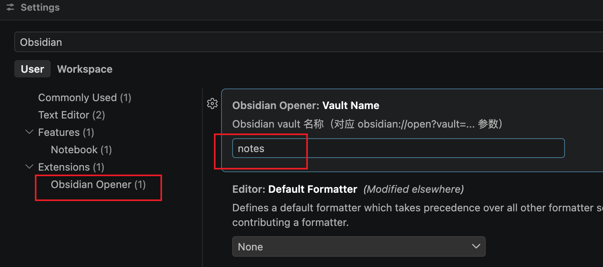

# Obsidian Opener

[English](./README.md) | [中文](#中文)

[](https://marketplace.visualstudio.com/items?itemName=leonezhu.obsidian-opener)

## 中文

在 VSCode 里编辑 Obsidian vault 的 md 文件时，一键跳回本地 Obsidian。

### 安装

从 VS Code 插件市场安装：

**[Obsidian Opener — Visual Studio Marketplace](https://marketplace.visualstudio.com/items?itemName=leonezhu.obsidian-opener)**

或从本地 `.vsix` 安装：

```bash
npx @vscode/vsce package --allow-missing-repository
code --install-extension obsidian-opener-0.3.1.vsix
```

### 用法

1. **快捷键**：Windows/Linux `Alt+O`，macOS `⌘⌥O`（⌘ + Option + O）
2. **按钮**：md 文件编辑器右上角有一个紫色宝石图标，点击即在 Obsidian 打开当前文件
3. **命令面板**：`Obsidian: 在 Obsidian 中打开当前文件`

### 工作原理

生成的 URL 有两种模式：

**自动模式（默认，零配置）**——文件在某个已注册 vault 内时，用文件绝对路径打开（`obsidian://open?path=...`，由 Obsidian 自动匹配 vault）；文件不在任何 vault 内时，插件改用系统方式把文件交给 Obsidian 以独立文件打开——注意 `path=` URI 本身**不支持** vault 外的文件（会报 "Vault not found"），独立文件打开需要 Obsidian 1.14+：

```bash
open -b md.obsidian /Users/me/Documents/a.md   # macOS
```

Windows/Linux 通过 `.md` 文件关联打开（1.14 起可将 Obsidian 设为默认 Markdown 应用）。

**指定 vault 模式**——设置 `obsidianOpener.vaultName` 后启用，用 vault 名 + 相对路径：

```
obsidian://open?vault=notes&file=References%2FDanKoe%2F2026-08-29-xxx
```

点击图标时，插件会先校验：当前文档所在 repo（工作区根）与该 vault 在 Obsidian 注册表中的实际目录是否一致：

- 一致 → 用 `vault=` + 相对 vault 根的路径打开（去掉 `.md` 后缀，URL 编码）
- 不一致（如文件属于别的仓库、或根本不在工作区内）→ 改用系统方式以独立文件交给 Obsidian（需 Obsidian 1.14+）
- 注册表里找不到该名字的 vault（无法校验）→ 保持旧行为，假定工作区根 = vault 根

### 配置

打开 VSCode 设置，搜索 "Obsidian"，把 **Obsidian Opener: Vault Name** 设为你的 vault 名称（即 vault 根目录的文件夹名，如 `notes`）：



| 设置项 | 默认值 | 说明 |
|---|---|---|
| `obsidianOpener.vaultName` | `""`（空） | 留空用自动模式；填写 vault 名称则用该 vault 打开，文件不在其中时按独立文件方式打开 |

### 测试

零依赖，用 Node 内置 test runner：

```bash
npm test
```

黄金用例来自真实 Obsidian URL（用户提供的 DanKoe 文章链接），逐字符比对。

## English

See [README.md](./README.md).
